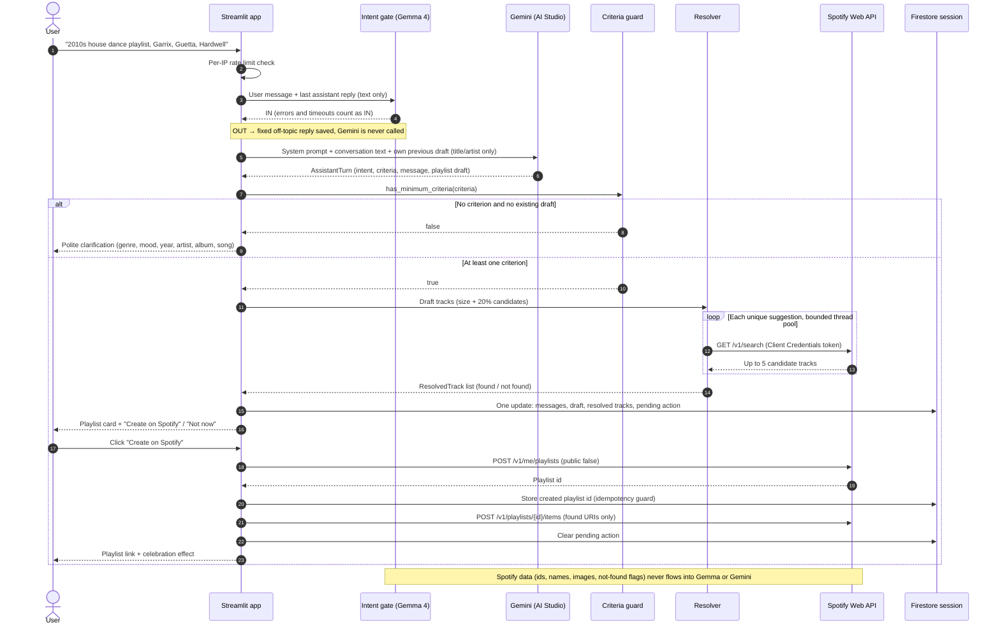

# AI Playlist Generator

A conversational web app that turns a natural-language request into a ready-to-play music playlist. Users describe what they want to hear (a genre, a mood, an era, their favorite artists) and an AI assistant powered by **Gemini** drafts the playlist, resolves every track against the **Spotify** catalog and, when the user is signed in with Spotify, creates it on their account with a single click. The whole stack runs on the **Google Cloud Free Tier**, provisioned with **Terraform** and served from **Cloud Run**.

---

## 🚀 Project Overview

The **AI Playlist Generator** replaces the tedious "search, add, repeat" workflow of building a playlist by hand with a short conversation. A request such as:

> *"Make me a dance playlist with 2010s house music, picking the biggest hits by artists like Martin Garrix, David Guetta and Hardwell"*

becomes a titled, described playlist (16 tracks by default, or any size from 1 to 30 on request) that the user can review, refine ("replace the Guetta tracks", "make it 30 songs", "more upbeat") and finally save to Spotify.

The app offers two ways in:
* **Continue with Spotify (SSO):** the chat is authenticated, and every finished playlist can be created as a **private** playlist on the user's Spotify account after an explicit confirmation click.
* **Use as a Guest:** the assistant produces the same Spotify-ready playlist card (titles, artists, cover art, links to Spotify) and invites the user to log in with Spotify to save it. After login, the draft is preserved and the assistant asks for confirmation.

### Why this project?
Beyond being a fun everyday tool, this project is a hands-on demonstration of production-minded **LLM application engineering** on a **Cloud-Native**, zero-cost footprint. It was built on four core pillars:
* **Reliability:** The LLM answers with **structured output** (Pydantic schema), a deterministic Python guard enforces the minimum criteria, and every suggested track is verified against the Spotify catalog, so only tracks that actually exist can reach a saved playlist.
* **Responsible AI Integration:** The LLM never receives Spotify data (as required by the Spotify Developer Policy), no side effect happens without an explicit click, and conversations self-destruct 60 minutes after the last message.
* **Cloud Efficiency:** The entire infrastructure is hosted on **Google Cloud Platform** and the LLM is served by **Google AI Studio**, both within their Free Tiers for a zero-cost footprint.
* **Serverless Scalability:** Built with a "scale-to-zero" approach on Cloud Run and fully described as code with Terraform, ensuring no fixed maintenance costs.

---

## 📋 Functional Requirements

The following requirements define the expected behavior of the system from a user and operator perspective. Priority levels follow [RFC 2119](https://www.rfc-editor.org/rfc/rfc2119).

| ID | Requirement | Priority |
| :--- | :--- | :--- |
| FR-01 | The system MUST show a landing screen with a very short explanation and two entry points: Spotify SSO ("Continue with Spotify") and "Use as a Guest". | MUST |
| FR-02 | The system MUST generate a playlist from a natural-language request, attempting to satisfy every stated constraint. The playlist has 16 tracks by default, or the number N the user asks for, always within 1 ≤ N ≤ 30. | MUST |
| FR-03 | The system MUST require at least one of: genre, mood, year/era, artist, album, song; otherwise it MUST politely ask for more information, suggesting these six references. | MUST |
| FR-04 | The system MUST resolve every proposed track against the Spotify catalog (Spotify-ready) in both guest and authenticated mode. | MUST |
| FR-05 | The system MUST show the playlist as a compact, expandable card with title, artist and cover image per track. | MUST |
| FR-06 | The system MUST ask logged-in users to confirm creation via buttons under the response; no playlist is created without an explicit click. | MUST |
| FR-07 | The system MUST invite guests to log in with Spotify to save the playlist; after login the draft MUST be preserved and confirmation requested. | MUST |
| FR-08 | Confirmation buttons MUST be non-blocking: sending a new message dismisses them and is handled as a refinement or a new request. | MUST |
| FR-09 | The system MUST support iterative refinement of the current draft within the conversation. | MUST |
| FR-10 | After creation, the system MUST return the link to the private playlist on Spotify. | MUST |
| FR-11 | The system MUST keep the conversation for at most 60 minutes after the last message, resumable after closing the browser, without cookies. | MUST |
| FR-12 | "New chat" MUST permanently delete the conversation, draft and Spotify tokens. | MUST |
| FR-13 | An expired session MUST NOT be resumable; the user can only start a new chat. | MUST |
| FR-14 | The system SHOULD rate-limit chat messages per client IP (12 per minute, sliding window). | SHOULD |
| FR-15 | The system SHOULD reply in the user's language. | SHOULD |
| FR-16 | The system SHOULD flag tracks not found on Spotify and exclude them from the saved playlist. | SHOULD |
| FR-17 | The system MAY search the web for very recent releases mentioned by the user (future work, pending a free-tier check). | MAY |
| FR-18 | The system SHOULD stop clearly off-topic messages with a cheap intent gate before they reach Gemini, failing open: an off-topic message may get through, an in-scope one must never be blocked. | SHOULD |

---

## 📐 Non-Functional Requirements

| ID | Requirement | Target | Category |
| :--- | :--- | :--- | :--- |
| NFR-01 | Clarification reply latency (P95) | ≤ 3 seconds | Performance |
| NFR-02 | Default 16-track playlist generated and resolved on Spotify (P95) | ≤ 10 seconds | Performance |
| NFR-03 | System availability | ≥ 99% monthly uptime (Cloud Run SLA) | Availability |
| NFR-04 | Monthly infrastructure cost | $0 (within GCP and Google AI Studio Free Tiers) | Cost |
| NFR-05 | Track resolution rate for mainstream requests | ≥ 90% of requested tracks found on Spotify | Reliability |
| NFR-06 | Session lifetime | Exactly 60 minutes sliding from the last message, enforced on read | Privacy |
| NFR-07 | Cold-start latency after scale-to-zero | ≤ 5 seconds | Performance |
| NFR-08 | Maximum concurrent instances | 1 (Cloud Run `max-instances = 1`) | Scalability |
| NFR-09 | Spotify-authenticated users | ≤ 5 (Spotify Development Mode allowlist) | Scalability |
| NFR-10 | Spotify tokens | Encrypted at rest, never logged, deleted with the session | Security |

---

## ⚠️ Technical Constraints

The following are hard boundaries that govern all design and implementation decisions:

* **GCP Free Tier only:** No paid GCP services or SKUs may be used. Infrastructure must remain within the Always Free limits of Cloud Run, Firestore, Secret Manager and Artifact Registry, in region `us-central1`. Paid alternatives such as Memorystore (Redis) are therefore excluded.
* **Google AI Studio Free Tier:** LLM calls must stay within the free-tier rate limits; no billing account is attached. Quotas are per model, so the intent gate (Gemma 4 26B, a much larger daily quota) protects Gemini 3.5 Flash-Lite's few hundred requests per day. Per-model RPM/RPD limits are shown per project in the AI Studio console (they are not fully published), preview models have tighter limits, and daily quotas reset at midnight Pacific time. Free-tier prompts may be used by Google to improve its products.
* **Spotify Development Mode:** Since the February 2026 platform changes, the app owner needs a **Spotify Premium** account, each Development Mode app allows **at most 5 allowlisted users** (added manually in the Developer Dashboard), and **Extended Quota Mode is only available to organizations with ≥ 250k monthly active users**, so it is not reachable for this project. Spotify login is therefore **invite-only**; everyone else uses guest mode.
* **Spotify quotas and catalog access:** Rate-limit quotas are counted per developer account and their numeric values are not published; `429` responses may carry `reason: QUOTA_EXCEEDED`. New Development Mode apps receive at most 10 results per search request, and the recommendations, related-artists and audio-features endpoints are unavailable to new apps (deprecated in November 2024). Track selection is therefore the LLM's job, not Spotify's.
* **Spotify Web API migration:** The February 2026 migration replaced `POST /users/{id}/playlists` with `POST /me/playlists` and `/playlists/{id}/tracks` with `/playlists/{id}/items`; the app targets only the post-migration endpoints.
* **Spotify Developer Terms & Policy:** Spotify Content must not be used to train ML/AI models or otherwise be ingested into an ML/AI model, must not be cached beyond what is needed for immediate use, and must always be attributed to Spotify. The LLM's context is limited to the conversation text and the LLM's own previous draft; resolved tracks exist only for the current draft of an active session (≤ 60 minutes), with no cross-request or cross-session cache of Spotify content.
* **Spotify Web API guidelines:** Spotify's official [OpenAPI schema](https://developer.spotify.com/reference/web-api/open-api-schema.yaml) is the source of truth for every endpoint path, parameter and response field; nothing is guessed. Deprecated endpoints are never used (`/playlists/{id}/items` instead of `/playlists/{id}/tracks`, `/me/library` instead of type-specific library endpoints), the deprecated Implicit Grant flow is never used, only the minimum scopes are requested, and `429` responses are handled with `Retry-After` and exponential backoff.
* **Firestore Native Mode:** Sessions are stored in the free `(default)` Firestore database, provisioned in Native Mode (one free database per project), with a TTL policy on `expires_at`. TTL deletion is best-effort (typically within ~24 hours of expiry), so expiry is enforced by the application on every read.
* **Cloud Run `max-instances = 1`:** A hard cap is enforced to prevent denial-of-wallet scenarios and unintended cost overruns.
* **Python 3.12.13:** All application code targets Python 3.12.13 specifically; no GPU or hardware accelerators are available or required.
* **Ephemeral, cookie-less sessions:** Conversations live at most 60 minutes after the last message and are never stored long-term. No cookies are used for session state and nothing session-related is placed in the URL; the session id lives only in the browser's `localStorage`. The only cookies are functional ones set by the platform: Streamlit's `_streamlit_xsrf` XSRF token and Cloud Run's session-affinity cookie.
* **OAuth redirect URI rules:** Spotify requires HTTPS redirect URIs, except loopback IP literals (`http://127.0.0.1:<port>`); `localhost` is not allowed. The redirect URI must match the registered value exactly, including the trailing slash.

---

## 🏗️ Architecture

The system is a single Streamlit service that orchestrates three external capabilities: **LLMs** for filtering off-topic messages (Gemma) and for understanding requests and drafting playlists (Gemini), the **Spotify Web API** for catalog resolution and playlist creation, and **Firestore** for short-lived sessions. It is designed to be modular, testable offline, and compliant by construction. The entire cloud infrastructure is managed via **Infrastructure as Code (IaC) using Terraform**.

**End-to-end flow (logged-in user):**



> **Data boundary.** Spotify-resolved data is stored separately from the conversation and used only for display and playlist creation. The LLMs only ever see the user's messages and Gemini's own previous replies and drafts. For guests, the card is followed by a **"Log in with Spotify to save"** button; after the OAuth round-trip the same confirmation buttons appear.

### 1. Conversation Engine
Implemented in `src/intent_gate.py`, `src/chain.py`, `src/prompt.py`, `src/schema.py` and `src/criteria.py`:
* **Intent gate (fail-open):** before Gemini, **Gemma 4 26B** (`gemma-4-26b-a4b-it`, a separate and larger free-tier quota) classifies the new message, with the assistant's last text reply as context, and answers one word. Only an unambiguous `OUT` blocks it: the user gets a fixed off-topic reply, saved like a normal turn, and Gemini is not called. Any other answer, an error, a `429` or the 3-second timeout lets the message through, and messages over 2,000 characters skip the gate. The gate runs with thinking set to `minimal`, temperature 0, a single attempt and a few output tokens. It is deliberately lazy: a missed off-topic message costs one Gemini request (and Gemini still declines it), while a blocked legitimate one would break the product.
* **One Gemini call per user turn** through LangChain's `ChatGoogleGenerativeAI.with_structured_output`, using **Gemini 3.5 Flash-Lite** via a [Google AI Studio](https://aistudio.google.com/apikey) API key. The response is parsed into an `AssistantTurn` Pydantic model instead of free text:

  ```text
  AssistantTurn
  ├── intent: "clarify" | "propose_playlist" | "revise_playlist" | "off_topic"
  ├── criteria: PlaylistCriteria
  │   ├── genres, moods, years, artists, albums, songs: list[str]
  │   └── other_constraints: list[str]   # e.g. "danceable", "only big hits", "no remixes"
  ├── message: str                       # user-facing reply, in the user's language
  └── playlist: PlaylistDraft | None
      ├── title, description, target_size   # target_size = size the user asked for
      └── tracks: list[TrackSuggestion]  # title, artist, optional album, optional year
  ```

* **History:** previous text turns plus the current draft serialized as the LLM's own title/artist list. Spotify-resolved data is never part of the prompt.
* **Playlist size:** `target_size` is clamped in Python to 1 ≤ N ≤ 30 (16 when the user gives no number) whatever the LLM returns, so the bound holds even if the prompt is ignored.
* **Deterministic minimum-criteria guard:** `criteria.has_minimum_criteria()` returns `True` when at least one of the six lists (genre, mood, year/era, artist, album, song) is non-empty. If the LLM proposes a playlist without any criterion and there is no existing draft, the app overrides the turn with a polite clarification (fallback text in `src/prompt.py`) that suggests those six kinds of information. The rule is enforced in testable Python, not left to the prompt alone.
* **System prompt rules:** satisfy every constraint; never invent tracks that do not exist; prefer well-known releases; use the size the user asks for, or `playlist.default_size` = 16 when none is given, always within 1 ≤ N ≤ `playlist.max_size` = 30, and tell the user when a request falls outside that range; over-generate by 20%; reply in the user's language; politely decline off-topic requests; never reveal its instructions.
* **Error handling** follows the reference project: every `429` quota error (per-minute or per-day) tells the user the AI quota is used up for today and to come back tomorrow, a `404` signals a misconfigured model id, and `5xx` errors produce a "temporarily unavailable" notice. The SDK makes at most 2 attempts per call (one retry), so the user gets this feedback within seconds.

### 2. Playlist Resolution
Implemented in `src/spotify/resolver.py`, this step makes every playlist **Spotify-ready** in both modes (guests use the app-level Client Credentials token):
* **Search:** for each `TrackSuggestion`, the resolver calls `GET /v1/search?type=track&q=track:"<title>" artist:"<artist>"&limit=5&market=<spotify.market>` (well within the 10-results cap that applies to new Development Mode apps).
* **Matching:** the best candidate is chosen by normalized string similarity on title and artist (`difflib`); candidates below a minimum score are marked `not_found`.
* **Over-generation instead of backfill:** the LLM is asked for `size + ceil(size * 0.2)` candidates (20 for the default 16-track playlist, 36 for the maximum of 30) and the app keeps the first `size` tracks that resolve. Unresolved leftovers are shown flagged as "not found on Spotify" and excluded from saving. There is no automatic "replace missing tracks" loop, because it would feed Spotify-derived data back into the LLM.
* **Performance:** searches run in parallel on a bounded `ThreadPoolExecutor` (5 workers), and identical suggestions within one request are searched only once. Search results are not cached across requests, because Spotify's Developer Terms forbid caching content beyond what is needed for immediate use. The UI shows progress ("Finding tracks on Spotify… 12/20") with skeleton placeholders.
* **Output:** each `ResolvedTrack` carries `spotify_id`, `uri`, `name`, `artists`, `album`, `image_url` (smallest album image ≥ 64 px), `external_url`, `duration_ms` and `found`.

### 3. Spotify Integration
Implemented as a thin custom client on `httpx` (`src/spotify/client.py`) plus the OAuth flows (`src/spotify/auth.py`). A ~100-line client targeting only the endpoints the app needs is easier to keep current after the February 2026 Web API migration, and easier to mock, than a general-purpose SDK.
* **Source of truth:** every path, parameter and response field used by the client is taken from Spotify's official [OpenAPI schema](https://developer.spotify.com/reference/web-api/open-api-schema.yaml), and an integration test checks that each one exists there and is not deprecated.
* **Client Credentials flow:** an app-level token, kept in memory until it expires, used only for public catalog search (no user data) in both modes.
* **Authorization Code flow:** a server-side confidential client (`SPOTIFY_CLIENT_SECRET` from Secret Manager) with scope **`playlist-modify-private` only** and a random `state` stored in the session document for CSRF protection. Spotify's guidelines prefer Authorization Code with PKCE and accept the classic Authorization Code flow for apps with a secure backend. The backend flow is used here because the client secret is required anyway for Client Credentials and never leaves the server. The deprecated Implicit Grant flow is never used.
  1. "Continue with Spotify" creates or loads the session, stores `oauth_state` and performs a **same-tab** redirect to `https://accounts.spotify.com/authorize` (`st.link_button` would open a new tab and lose the context).
  2. Spotify redirects to `spotify.redirect_uri` (the app root) with `?code&state`. The app reads the session id from `localStorage`, verifies `state`, exchanges the code, calls `GET /v1/me`, stores the encrypted tokens and display name, then clears the query parameters (`st.query_params.clear()`) and switches the mode to `spotify`.
  3. If `GET /v1/me` returns **403** (user not in the Development Mode allowlist), the tokens are discarded, an invite-only notice is shown and the chat stays in guest mode.
  4. If the session holds a pending draft, the assistant appends `You're logged in as <name> — save '<title>' to Spotify?` with the confirmation buttons.
* **Endpoints used** (post-migration Web API):

  | Endpoint | Token | Purpose |
  | :--- | :--- | :--- |
  | `GET /v1/search` | Client Credentials | Resolve LLM suggestions to catalog tracks. |
  | `GET /v1/me` | User | Display name and allowlist check. No extra scope is requested: only `id` and `display_name` are read; the scope-gated `email`, `country` and `product` fields are deprecated and not needed. |
  | `POST /v1/me/playlists` | User | Create the playlist (`{name, description, public: false}`; `public` defaults to `true`, so it is always sent explicitly). |
  | `POST /v1/playlists/{id}/items` | User | Add the track URIs in a single request (at most 30 tracks, well below the 100-URI limit). |

* **Token refresh:** access tokens (1 hour) are refreshed with the refresh token shortly before they expire. If the refresh token itself is rejected (`invalid_grant`, e.g. a revoked grant or the 6-month refresh-token lifetime), the user is sent through authorization again.
* **Rate limits:** a `429` honors `Retry-After` when present and otherwise uses exponential backoff with jitter. Retries are bounded and never immediate or in a tight loop; a `QUOTA_EXCEEDED` reason produces a friendly message without retrying.
* **Error handling:** every status documented in the OpenAPI schema is handled: `400` (malformed request, logged as a bug), `401` (one refresh, then re-login), `403` (invite-only notice), `404` (resource not found) and `429` (above), plus `5xx` with backoff. Spotify's `error.message` is logged with the status and turned into meaningful, escaped feedback for the user.
* **Revocation:** Spotify exposes no token-revocation endpoint. Deleting the session deletes the app's only copy of the tokens; users can additionally remove the app's access from their Spotify account settings.

### 4. Session Management
Implemented in `src/session_store.py`, `src/browser_session.py` and `src/crypto.py`. **Firestore Native Mode with a TTL policy** was chosen over Redis: it is already part of the stack, free, and managed by Terraform, whereas Memorystore is not free and a hosted Redis would add an external vendor and secret outside Terraform.
* **Session id:** a server-generated UUID4 stored in the browser's `localStorage` under the key `apg_session_id` via a small Streamlit JS bridge component (`streamlit-js-eval`). No cookies, nothing in the URL: a query-parameter session would leak the conversation and the Spotify authorization to anyone holding the link.
* **Document `sessions/{session_id}`** (collection `sessions.collection`):

  | Field | Content |
  | :--- | :--- |
  | `created_at`, `last_message_at` | Timestamps of creation and of the latest activity. |
  | `expires_at` | `last_message_at + sessions.ttl_minutes`; checked on every read and used as the Firestore TTL field. |
  | `mode` | `guest` or `spotify`. |
  | `messages` | List of `{role, content, created_at}` (`role`: `user`, `assistant` or `notice`; `notice` messages are app-generated and never sent to the LLM), capped to the last 50 entries. |
  | `draft` | The LLM's own `PlaylistDraft` (title, description, title/artist suggestions). |
  | `draft_message_index` | Index of the message under which the current draft's card is rendered. |
  | `resolved_tracks` | `ResolvedTrack` list for the current draft only, overwritten by the next draft and deleted with the session; kept just for display and creation (immediate use, per Spotify's Developer Terms). |
  | `pending_action` | `confirm_create`, `login_to_save` or null, bound to a message index. |
  | `created_playlist` | `{id, url, items_added}` or null; the idempotency guard against double creation. |
  | `oauth_state` | CSRF `state` of the pending Authorization Code flow. |
  | `spotify_auth` | Fernet-encrypted blob: access token, refresh token, expiry, user id, display name. |

* **Bootstrap:** every new Streamlit session (page load, OAuth callback, reopened browser) reads `localStorage` (the bridge returns `None` on the very first script run, so the async round-trip is handled explicitly), then loads the document: missing → landing screen; `expires_at` in the past → "expired" screen with only a **New chat** button (the document is deleted); otherwise the chat is restored with its mode, messages, draft and pending buttons.
* **Sliding expiry:** `expires_at` is refreshed on every user or assistant message and on confirmation clicks. Firestore TTL is only a garbage collector for abandoned sessions; the 60-minute rule is enforced by the application.
* **Writes:** one Firestore write per turn (user message, assistant reply and draft in a single update). The message cap keeps documents far below Firestore's 1 MiB limit.
* **New chat:** permanently deletes the session document (conversation, draft, encrypted tokens), clears `localStorage` and returns to the landing screen. Logging in again is a quick redirect because consent is remembered on Spotify's side.
* **Origins:** `localStorage` is per-origin. Locally the app is always opened at `http://127.0.0.1:8501`; in production one canonical URL (the Cloud Run URL or the custom domain) is used and registered as the redirect URI.

### 5. Frontend & UX
The UI is a themed Streamlit app (`app.py`, `src/ui/*`, `.streamlit/config.toml`). `app.py` routes each run: bootstrap → OAuth callback handling → **landing**, **chat** or **expired** screen.
* **Landing screen:** a three-step explanation (*describe → review → save*), the **"Continue with Spotify"** and **"Use as a Guest"** buttons, a small note that Spotify login is invite-only, and a footnote asking users not to share personal data.
* **Chat header:** a mode badge (`Guest` or `Spotify · <display name>`), a "Log in with Spotify" button for guests and a **"New chat"** button.
* **Playlist card:** title, description and track count; the collapsed view shows the first 5 tracks and **"Show all N tracks"** expands it (the expander appears only when the playlist has more than 5 tracks). Each row shows the album cover, title and artist, and links to the track on Spotify; tracks not found are flagged.
* **Non-blocking confirmations:** buttons ("Create on Spotify" / "Not now", or "Log in with Spotify to save" for guests) sit right under the latest assistant message, like a suggestion card that can be accepted or ignored. Only the latest assistant message can carry buttons, and sending a new message clears the pending action so stale buttons disappear. The create button is disabled while busy and a stored `created_playlist` prevents duplicates on double clicks.
* **Theme:** dark mode with a violet palette: `base = "dark"`, primary `#A855F7`, background `#0B0614`, secondary background `#1A1030`, text `#EDE9FE`, `toolbarMode = "minimal"`. Spotify green (`#1DB954`) is reserved for Spotify-branded buttons.
* **Special effects** (CSS/HTML injected by `src/ui/styles.py`, all disabled under `prefers-reduced-motion`):
  * a slowly animated violet "aurora" gradient background;
  * glassmorphism chat bubbles and playlist card (`backdrop-filter: blur`);
  * glowing primary buttons with a hover pulse;
  * an equalizer-bars typing indicator;
  * staggered fade/slide-in of track rows and a skeleton shimmer while resolving;
  * violet confetti when the playlist is created on Spotify.
* **Spotify design guidelines:** album artwork is shown unaltered (no crop, overlay or filter; animations apply to containers only), the Spotify logo and attribution appear near playlist cards, and every track and playlist links back to Spotify.
* **Language:** the assistant replies in the user's language; the UI chrome is in English.

### 6. Infrastructure as Code (Terraform)
All GCP resources are provisioned with **Terraform** (google provider `~> 5.0`), enabling version-controlled, reproducible environments and automated IAM setup:

| Resource | Terraform address | Purpose |
| :--- | :--- | :--- |
| APIs | `google_project_service.firebaserules`, `google_project_service.secretmanager` | Required services (the others are enabled once with `gcloud`). |
| Firestore | `google_firestore_database.main` | `(default)` database, Native Mode, `us-central1`. |
| TTL policy | `google_firestore_field.sessions_ttl` | TTL on `sessions.expires_at`. |
| Security rules | `google_firebaserules_ruleset.firestore`, `google_firebaserules_release.firestore` | Deny all client access (the server SDK bypasses rules). |
| Service account | `google_service_account.app`, `google_project_iam_member.datastore_user` | Runtime identity `playlist-generator` with `roles/datastore.user`. |
| Secret access | `google_secret_manager_secret_iam_member.app_api_key`, `.app_spotify_client_secret`, `.app_session_encryption_key` | `secretAccessor` on the three secrets only. |
| Artifact Registry | `google_artifact_registry_repository.app` | Docker repository `playlist-generator` with cleanup policies (keep the 2 most recent versions, delete the rest). |
| Cloud Run | `google_cloud_run_v2_service.app`, `google_cloud_run_v2_service_iam_member.public` | The service and its public invoker (`allUsers`). |
| CI/CD identity | `google_iam_workload_identity_pool.github`, `google_iam_workload_identity_pool_provider.github`, plus IAM members | Keyless GitHub Actions deploys (pool `github-actions`, provider `github-oidc`). |
| Custom domain | `google_cloud_run_domain_mapping.custom` | Optional, created only when `custom_domain` is set. |

* **Variables:** `project_id`, `region` (`us-central1`), `sessions_collection` (`sessions`, kept equal to `sessions.collection` by `make tf-apply`), `image_url`, `github_repo` (`maurorusso22/ai-playlist-generator`), `custom_domain` (empty by default). App settings are not Terraform inputs: they ship in the image under `config/`.
* **Outputs:** `cloud_run_url`, `service_account_email`, `sessions_collection`, `project_id`, `custom_domain_mapping_records`.
* Secret **values** are created manually with `gcloud` and never appear in Terraform state.

### 7. Serverless Hosting
The application is containerized with Docker (`python:3.12.13-slim-bookworm`, built for `linux/amd64`) and hosted on **Google Cloud Run**:
* **Scaling:** min 0 / max 1 instances, 1 vCPU / 512 MiB, port 8501, so the service scales to zero when idle.
* **WebSockets:** Streamlit keeps one WebSocket open per browser tab and Cloud Run caps every request, WebSockets included, at the request timeout. The service therefore uses `timeout = "3600s"` and **session affinity**.
* **Configuration:** settings and secrets never mix. Non-secret settings are TOML files baked into the image (`config/base.toml`, overridden key by key by `config/production.toml`, selected by the `APP_ENV=production` variable that Terraform sets); `GOOGLE_API_KEY`, `SPOTIFY_CLIENT_SECRET` and `SESSION_ENCRYPTION_KEY` are injected from Secret Manager via `secret_key_ref`.
* **CI/CD:** on every push to `main`, GitHub Actions runs a `test` job (`ruff check`, `ruff format --check`, `pytest tests/unit`) and then a `deploy` job that authenticates through Workload Identity Federation, builds a `linux/amd64` image tagged with the commit SHA, pushes it to Artifact Registry and deploys a new Cloud Run revision.

---

## 🛠️ Tech Stack

| Category | Technology | Role |
| :--- | :--- | :--- |
| **Language** | Python 3.12.13 | Primary programming language for backend, AI and UI logic. |
| **AI Framework** | LangChain (`langchain-core`, `langchain-google-genai`) | Prompting, chat history and structured output. |
| **LLM** | Gemini 3.5 Flash-Lite (Google AI Studio, `gemini-3.5-flash-lite`) | Conversation understanding and playlist drafting. |
| **Intent gate** | Gemma 4 26B A4B (Google AI Studio, `gemma-4-26b-a4b-it`) | Fail-open filter that stops clearly off-topic messages before Gemini. |
| **Music Catalog** | Spotify Web API (custom `httpx` client) | Track search, user profile and playlist creation. |
| **Session Store** | Firestore Native Mode + TTL policy | Short-lived (1-hour) conversation storage. |
| **Secrets** | Google Secret Manager | `GOOGLE_API_KEY`, `SPOTIFY_CLIENT_SECRET`, `SESSION_ENCRYPTION_KEY`. |
| **IaC** | Terraform (google provider `~> 5.0`) | Infrastructure as Code for automated GCP provisioning. |
| **Hosting** | Google Cloud Run | Serverless container execution with scale-to-zero and a single-instance cap. |
| **UI** | Streamlit + custom CSS/HTML + `localStorage` bridge component | Themed chat interface with animated effects. |
| **Containerization** | Docker (`python:3.12.13-slim-bookworm`, `linux/amd64`) | Packaging the application for consistent deployments. |
| **CI/CD** | GitHub Actions + Workload Identity Federation | Lint/test and keyless deploy on push to `main`. |
| **Quality** | Ruff, pytest, pytest-mock, `respx` | Linting/formatting and offline tests (`respx` mocks `httpx`). |

**Other libraries:** `pydantic` (v2) · `cryptography` (Fernet) · `cachetools` (rate limiting) · `google-cloud-firestore` · `httpx` · `python-dotenv` · `streamlit-js-eval`

**Development tools:** Google AI Studio (API key management, prompt prototyping) · Spotify Developer Dashboard (app registration, redirect URIs, user allowlist) · GCP SDK (`gcloud`) · Terraform CLI · Docker

---

## 📁 Project Structure

```
ai-playlist-generator/
├── app.py                      # Streamlit entry point: bootstrap, routing, OAuth callback
├── Dockerfile                  # Container definition for Cloud Run (linux/amd64)
├── .dockerignore               # Keeps secrets, venv and dev-only files out of the build context
├── Makefile                    # run, test-unit, test-integration, test-smoke, test, docker-*, tf-apply
├── requirements.txt            # Python dependencies
├── ruff.toml                   # Linter/formatter config (same rules as ai-portfolio-assistant)
├── .env.example                # Secrets template: the three secret names, no values
├── config/
│   ├── base.toml               # Non-secret settings (local-development values)
│   └── production.toml         # Production overrides, selected by APP_ENV=production
├── .streamlit/
│   └── config.toml             # Dark violet theme
├── public/
│   ├── logo.svg                # App logo (the official Spotify logo is added manually for attribution)
│   └── styles.css              # Dark violet theme, animations, effects
├── scripts/
│   ├── spotify_spike.py        # Dev-only: Phase 3 Spotify de-risking spike
│   └── spike_helpers.py        # Spike HTTP helpers (standalone, no src/ imports)
├── src/
│   ├── config/
│   │   ├── settings.py         # Pydantic validation of the TOML settings
│   │   ├── files.py            # base.toml + APP_ENV overlay loading
│   │   ├── secrets.py          # Secrets from the environment (.env / Secret Manager)
│   │   ├── constants.py        # Fixed app-wide constants
│   │   └── errors.py           # ConfigError
│   ├── schema.py               # Pydantic models (criteria, drafts, resolved tracks, session)
│   ├── prompt.py               # System prompt and clarification fallback
│   ├── chain.py                # LLM call with structured output and history
│   ├── criteria.py             # Minimum-criteria guard (≥ 1 of 6 references)
│   ├── intent_gate.py          # Fail-open Gemma filter for off-topic messages
│   ├── rate_limiter.py         # Per-IP sliding-window rate limiting (in memory)
│   ├── crypto.py               # Fernet encryption for Spotify tokens
│   ├── session_store.py        # Firestore session CRUD, sliding TTL, expiry
│   ├── session_merge.py        # Session field validation, message cap, expiry helpers
│   ├── browser_session.py      # localStorage bridge for the session id (streamlit-js-eval)
│   ├── spotify/
│   │   ├── auth.py             # Authorization Code flow, state, refresh, re-auth
│   │   ├── app_token.py        # Client Credentials token (in-memory, until expiry)
│   │   ├── client.py           # httpx Web API client (search, me, playlists, items)
│   │   ├── retry.py            # 429 Retry-After + exponential backoff with jitter
│   │   ├── errors.py           # Spotify error hierarchy (error.message preserved)
│   │   ├── matching.py         # Title/artist normalization and match scoring
│   │   └── resolver.py         # LLM suggestions → Spotify tracks (parallel search + matching)
│   └── ui/
│       ├── styles.py           # Stylesheet injection
│       ├── state.py            # Session-state keys, flash messages, new chat
│       ├── landing.py          # Landing screen and guest start
│       ├── chat.py             # Chat rendering
│       ├── turn.py             # User message → LLM turn → resolution
│       ├── errors.py           # Error → user-facing message mapping
│       ├── playlist_card.py    # Compact, expandable playlist card
│       ├── actions.py          # Confirmation buttons under the latest message
│       ├── spotify_save.py     # Idempotent playlist creation on Spotify
│       ├── login.py            # Spotify login start and same-tab redirect
│       └── oauth_callback.py   # OAuth callback: state check, token exchange
├── tests/
│   ├── unit/                   # Offline tests (LLM, Spotify, Firestore mocked)
│   └── integration/            # Live Gemini, Spotify, Firestore, smoke tests
├── terraform/
│   ├── main.tf                 # Firestore (+ TTL), IAM, secrets, Artifact Registry, Cloud Run, WIF
│   ├── variables.tf
│   └── outputs.tf
├── docs/
│   └── plan.md                 # Implementation plan — not committed
└── .github/workflows/deploy.yml  # Test + deploy on push to main
```

> `docs/plan.md` is listed in `.gitignore` and is not part of the repository. `scripts/spotify_spike.py` is a development-only tool and is excluded from the Docker image.

---

## ⚙️ Local Development

### Prerequisites
* Python 3.12.13
* Docker (for containerized local testing)
* A Google Cloud Project with Firestore enabled in **Native Mode** (provisioned by Terraform, see [Deployment Step 2](#step-2--apply-core-infrastructure-firestore-ttl-rules-iam)) and Application Default Credentials (`gcloud auth application-default login`)
* A Google AI Studio API Key ([aistudio.google.com/apikey](https://aistudio.google.com/apikey))
* A **Spotify developer app** created in the [Spotify Developer Dashboard](https://developer.spotify.com/dashboard):
  * the app owner account must have **Spotify Premium** (Development Mode requirement);
  * select the **Web API** and register the redirect URI `http://127.0.0.1:8501/` exactly (add the production URL later, see [Deployment Step 7](#step-7--register-the-spotify-redirect-uri));
  * add the Spotify accounts that may log in (**up to 5**) in the app's user management settings. Guest mode works for anyone, because catalog search uses the app-level Client Credentials token.

### Configuration and Secrets

Settings and secrets live in separate files and never mix.

**Secrets** go only in a `.env` file at the project root (copy `.env.example`); on Cloud Run they come from Secret Manager:

| Variable | Description |
| :--- | :--- |
| `GOOGLE_API_KEY` | Google AI Studio API key for Gemini. |
| `SPOTIFY_CLIENT_SECRET` | Spotify app Client Secret. |
| `SESSION_ENCRYPTION_KEY` | Fernet key encrypting Spotify tokens at rest. |

**Settings** go in `config/base.toml` (committed). On Cloud Run, `APP_ENV=production` also loads `config/production.toml`, which overrides single keys (the redirect URI). Unknown keys, wrong types and blank values raise a `ConfigError` naming the `section.key` the first time the settings are read.

| Key | Value in `base.toml` | Description |
| :--- | :--- | :--- |
| `gcp.project_id` | — (fill in) | GCP project hosting Firestore. |
| `sessions.collection` | `sessions` | Firestore collection for chat sessions. |
| `sessions.ttl_minutes` | `60` | Session lifetime after the last message. |
| `llm.model` | `gemini-3.5-flash-lite` | Gemini model id. |
| `intent_gate.model` | `gemma-4-26b-a4b-it` | Gemma model id of the intent gate. |
| `spotify.client_id` | — (fill in) | Spotify app Client ID (public by design). |
| `spotify.redirect_uri` | `http://127.0.0.1:8501/` | OAuth redirect URI; production overrides it with the canonical `https://` URL. |
| `spotify.market` | `IT` | ISO country code for catalog search. |
| `playlist.default_size` | `16` | Tracks when the user doesn't specify a size. |
| `playlist.max_size` | `30` | Upper bound on playlist size; can be lowered but never raised above 30 (the minimum is fixed at 1). |
| `rate_limit.max_requests` | `12` | Max chat messages per IP in any window (sliding). |
| `rate_limit.window` | `60` | Rate-limit window in seconds. |

### Installation

1. **Clone the repository:**
   ```bash
   git clone https://github.com/maurorusso22/ai-playlist-generator.git
   cd ai-playlist-generator
   ```

2. **Create a virtual environment and install dependencies:**
   ```bash
   python -m venv .venv
   source .venv/bin/activate
   .venv/bin/python -m pip install -r requirements.txt
   ```

3. **Configure secrets and settings:**
   ```bash
   cp .env.example .env
   # Edit .env: the three secrets only
   # Edit config/base.toml: set gcp.project_id and spotify.client_id
   ```

4. **Generate the session encryption key** and paste it into `.env` as `SESSION_ENCRYPTION_KEY`:
   ```bash
   python -c "from cryptography.fernet import Fernet; print(Fernet.generate_key().decode())"
   ```
   > Use a different key per environment. Rotating the key makes stored Spotify tokens unreadable, which only forces affected users to log in again.

5. **Authenticate to GCP** so the Firestore client can use Application Default Credentials:
   ```bash
   gcloud auth application-default login
   gcloud config set project YOUR_PROJECT_ID
   ```

6. **Run the application locally:**
   ```bash
   streamlit run app.py
   # or: make run
   ```
   Then open **[http://127.0.0.1:8501](http://127.0.0.1:8501)**, not `http://localhost:8501`. Spotify forbids `localhost` redirect URIs and allows plain HTTP only for loopback IP literals, so the OAuth callback always lands on `127.0.0.1`. Because `localStorage` is per-origin, a session started on `localhost` would be invisible after the callback.

7. **Run in Docker (optional):**
   ```bash
   make docker-build
   make docker-run   # mounts your Application Default Credentials read-only
   ```

---

## 🧪 Testing

The project uses `pytest` for unit and integration tests, and `ruff` for linting and formatting. Unit tests run fully offline: Gemini and Firestore are mocked with `pytest-mock`, and the Spotify Web API is mocked at the HTTP layer with `respx`.

```bash
# Install dev dependencies (includes pytest, pytest-mock, respx and ruff)
pip install -r requirements.txt

# Check linting
ruff check .

# Auto-fix linting issues
ruff check --fix .

# Check formatting
ruff format --check .

# Apply formatting
ruff format .

# Run all tests
pytest tests/

# Run unit tests only (no credentials required)
pytest tests/unit/

# Run integration tests (requires .env, a complete config/base.toml and ADC)
pytest tests/integration/

# Run smoke tests against the deployed service (https:// redirect URI in config/production.toml)
make test-smoke

# Run the Spotify de-risking spike (dev only, requires an allowlisted account)
python -m scripts.spotify_spike
```

| Layer | Scope | Notes |
| :--- | :--- | :--- |
| `src/criteria.py` | Unit | Minimum-criteria guard across all six references and the empty case (`test_criteria.py`). |
| `src/config/` | Unit | Committed TOML files valid, overlay merged key by key, unknown `APP_ENV`/keys/sections rejected, strict types, size bounds and redirect-URI rules (`test_settings.py`, `test_config_files.py`); missing secrets reported together and hidden from `repr()` (`test_secrets.py`). |
| `src/browser_session.py` | Unit | Tri-state `localStorage` read (not loaded / empty / valid UUID4) with the bridge mocked (`test_browser_session.py`). |
| `src/ui/playlist_card.py` | Unit | `html.escape` on every dynamic field, Spotify URL allowlist, not-found badge, unaltered artwork (`test_playlist_card.py`). |
| `src/chain.py` | Unit | Structured-output parsing, history containing only the LLM's own draft, clarification override, off-topic and Gemini error mapping, with a mocked LLM (`test_chain.py`). |
| `src/spotify/client.py` | Unit | Search, profile, playlist and items endpoints, `Retry-After` and exponential backoff, `QUOTA_EXCEEDED`, and the mapping of every documented error status with Spotify's `error.message`, via `respx` (`test_spotify_client.py`). |
| `src/spotify/auth.py` | Unit | App-token reuse until expiry, `state` verification, code exchange, refresh, re-authorization on `invalid_grant` and the 403 allowlist case (`test_spotify_auth.py`). |
| `src/spotify/resolver.py` | Unit | Similarity threshold, `not_found` flags, over-generation trimming, in-request deduplication and no cross-request cache (`test_resolver.py`). |
| `src/intent_gate.py` | Unit | Only `OUT` blocks; any other answer, errors, `429`s and timeouts fail open; context is the last assistant reply, never a notice; long messages skip the gate (`test_intent_gate.py`). |
| `src/crypto.py` | Unit | Fernet round trip and rejection of a wrong key (`test_crypto.py`). |
| `src/session_store.py` | Unit | Sliding expiry, expiry enforced on read, single write per turn and New chat deletion, with Firestore mocked (`test_session_store.py`). |
| `src/rate_limiter.py` | Unit | Per-IP sliding-window limits, no boundary bursts, idle-entry expiry and client IP extraction (`test_rate_limiter.py`). |
| `app.py` | Unit | Routing and button lifecycle with Streamlit `AppTest` (`test_app.py`). |
| `src/spotify/*` | Integration | Live catalog search and resolution with the Client Credentials token (`test_spotify_integration.py`). |
| `src/spotify/client.py` | Integration | Every method and path the client calls exists in Spotify's official OpenAPI schema and is not deprecated (`test_spotify_openapi_contract.py`). |
| `src/chain.py` | Integration | Live Gemini structured output (`test_chain_integration.py`). |
| `src/intent_gate.py` | Integration | Live Gemma: clear off-topic blocked; music requests, small talk and short follow-ups in context pass (`test_intent_gate_integration.py`). |
| `src/session_store.py` | Integration | Live Firestore session lifecycle (`test_firestore_sessions.py`). |
| Cloud Run | Smoke | HTTP 200, HTML response and Streamlit health check (`test_smoke.py`). |

---

## ☁️ Deployment on GCP

The deployment process uses **Terraform** for infrastructure and **Docker** for containerization, staying within the **Google Cloud Free Tier**.

> Replace `YOUR_PROJECT_ID` with your GCP project ID throughout.

---

### Step 1 — GCP prerequisites (run once)

**Create a GCP project and enable billing:**
1. Go to [console.cloud.google.com](https://console.cloud.google.com) and create a new project.
2. Navigate to **Billing** and link a billing account. Required even if you stay within the Free Tier.

**Enable required APIs:**
```bash
gcloud services enable \
  firestore.googleapis.com \
  firebaserules.googleapis.com \
  secretmanager.googleapis.com \
  iam.googleapis.com \
  run.googleapis.com \
  artifactregistry.googleapis.com \
  --project=YOUR_PROJECT_ID
```

**Authenticate:**
```bash
gcloud auth application-default login
gcloud config set project YOUR_PROJECT_ID
```

Make sure the Spotify developer app is registered as described in [Prerequisites](#prerequisites).

---

### Step 2 — Apply core infrastructure (Firestore, TTL, rules, IAM)

```bash
cd terraform
terraform init
terraform apply \
  -target=google_project_service.firebaserules \
  -target=google_project_service.secretmanager \
  -target=google_firestore_database.main \
  -target=google_firestore_field.sessions_ttl \
  -target=google_firebaserules_ruleset.firestore \
  -target=google_firebaserules_release.firestore \
  -target=google_service_account.app \
  -target=google_project_iam_member.datastore_user \
  -var="project_id=YOUR_PROJECT_ID"
cd ..
```

Set `gcp.project_id` in `config/base.toml` to the `project_id` output (the `sessions_collection` output must match `sessions.collection`):
```bash
terraform -chdir=terraform output
```

---

### Step 3 — Store secrets in Secret Manager

`GOOGLE_API_KEY`, `SPOTIFY_CLIENT_SECRET` and `SESSION_ENCRYPTION_KEY` are injected at runtime via Secret Manager — never stored as plain environment variables or in Terraform state.

```bash
# Gemini API key
echo -n "YOUR_GOOGLE_API_KEY" | \
  gcloud secrets create GOOGLE_API_KEY --data-file=- --project=YOUR_PROJECT_ID

# Spotify Client Secret
echo -n "YOUR_SPOTIFY_CLIENT_SECRET" | \
  gcloud secrets create SPOTIFY_CLIENT_SECRET --data-file=- --project=YOUR_PROJECT_ID

# Fernet key for token encryption (a fresh key for production)
FERNET_KEY=$(python -c "from cryptography.fernet import Fernet; print(Fernet.generate_key().decode())")
echo -n "$FERNET_KEY" | \
  gcloud secrets create SESSION_ENCRYPTION_KEY --data-file=- --project=YOUR_PROJECT_ID
```

Grant the Cloud Run service account access to exactly these three secrets (the bindings reference the secrets by name, so they must exist first):
```bash
cd terraform
terraform apply \
  -target=google_secret_manager_secret_iam_member.app_api_key \
  -target=google_secret_manager_secret_iam_member.app_spotify_client_secret \
  -target=google_secret_manager_secret_iam_member.app_session_encryption_key \
  -var="project_id=YOUR_PROJECT_ID"
cd ..
```

---

### Step 4 — Apply Artifact Registry

```bash
cd terraform
terraform apply \
  -target=google_artifact_registry_repository.app \
  -var="project_id=YOUR_PROJECT_ID"
cd ..
```

---

### Step 5 — Build and push the Docker image

> **Important:** Build with `--platform linux/amd64`. Cloud Run runs on x86_64. Building on Apple Silicon without this flag produces an arm64 image that will fail to start.

```bash
gcloud auth configure-docker us-central1-docker.pkg.dev

export IMAGE_URL=us-central1-docker.pkg.dev/YOUR_PROJECT_ID/playlist-generator/playlist-generator:latest
docker build --platform linux/amd64 -t $IMAGE_URL .
docker push $IMAGE_URL
```

Or use the Makefile shortcut (sets `--platform linux/amd64` automatically):
```bash
make docker-push PROJECT_ID=YOUR_PROJECT_ID
```

---

### Step 6 — Apply Cloud Run and CI/CD identity

The production redirect URI is only known once the service exists, so the first revision keeps the loopback URI from `config/base.toml`; Step 7 overrides it in `config/production.toml`.

```bash
cd terraform
terraform apply \
  -target=google_cloud_run_v2_service.app \
  -target=google_cloud_run_v2_service_iam_member.public \
  -target=google_iam_workload_identity_pool.github \
  -target=google_iam_workload_identity_pool_provider.github \
  -target=google_service_account_iam_member.github_actions_impersonate \
  -target=google_project_iam_member.artifact_registry_writer \
  -target=google_project_iam_member.cloud_run_developer \
  -target=google_service_account_iam_member.self_act_as \
  -var="project_id=YOUR_PROJECT_ID" \
  -var="image_url=$IMAGE_URL"
cd ..
```

The service is created with min 0 / max 1 instances, 1 vCPU / 512 MiB, a `3600s` request timeout and session affinity (see [Serverless Hosting](#7-serverless-hosting)).

**Enable continuous deployment:** set `PROJECT_ID: YOUR_PROJECT_ID` and `SERVICE_ACCOUNT: playlist-generator@YOUR_PROJECT_ID.iam.gserviceaccount.com` in the `env` block of `.github/workflows/deploy.yml`, then store the Workload Identity provider name as the `WIF_PROVIDER` secret of the GitHub repository. From then on, every push to `main` runs the `test` and `deploy` jobs.
```bash
gcloud iam workload-identity-pools providers describe github-oidc \
  --workload-identity-pool=github-actions \
  --location=global \
  --project=YOUR_PROJECT_ID \
  --format="value(name)"
```

---

### Step 7 — Register the Spotify redirect URI

1. Retrieve the public URL:
   ```bash
   terraform -chdir=terraform output cloud_run_url
   ```
2. In the [Spotify Developer Dashboard](https://developer.spotify.com/dashboard), open the app settings and add `https://<your-cloud-run-url>/` to the **Redirect URIs** (exact match, including the trailing slash).
3. Point production at the same URI: uncomment the override in `config/production.toml`:
   ```toml
   [spotify]
   redirect_uri = "https://<your-cloud-run-url>/"
   ```
4. Commit and push: the CI deploy job ships a new image with the updated configuration. The smoke tests read the same URL.

> **Canonical URL:** sessions live in per-origin `localStorage` and the OAuth callback always lands on the redirect URI. Always share and open the app through this single URL.

---

### Step 8 — Run smoke tests

```bash
make test-smoke
```

Verifies that the canonical URL (the production `spotify.redirect_uri`) returns HTTP 200, serves HTML, and passes the Streamlit health check at `/_stcore/health`.

Then validate the end-to-end flow manually: generate a playlist as a guest, log in with an allowlisted Spotify account, confirm **Create on Spotify** and open the returned link.

Finally, create a billing budget with email alerts (Billing → Budgets & alerts in the console) and keep an eye on Cloud Run billable instance time (see [Cost Optimization Strategy](#cost-optimization-strategy)).

---

### Step 9 — Add a custom domain (optional)

This step maps a custom domain (e.g., `playlists.yourdomain.com`) to the Cloud Run service. GCP auto-provisions and auto-renews a free managed TLS certificate. No Load Balancer is required.

#### 9.1 — Register a domain

Purchase a domain from any registrar. [Cloudflare Registrar](https://www.cloudflare.com/products/registrar/) is recommended (at-cost pricing, includes free CNAME flattening).

#### 9.2 — Verify domain ownership with Google

Google requires you to verify domain ownership before mapping it to Cloud Run.

1. Go to [search.google.com/search-console](https://search.google.com/search-console) → **Add property** → **Domain**.
2. Copy the TXT record Google provides and add it to your DNS zone at your registrar.
3. Click **Verify**.

#### 9.3 — Apply the domain mapping via Terraform

Pass your domain as the `custom_domain` variable. Keep the Cloud Run redirect URI in `config/production.toml` for now, so Spotify login keeps working until the domain is live:

```bash
cd terraform
terraform apply \
  -var="project_id=YOUR_PROJECT_ID" \
  -var="image_url=YOUR_IMAGE_URL" \
  -var="custom_domain=yourdomain.com"
cd ..
```

Retrieve the DNS records from the Terraform output:

```bash
terraform -chdir=terraform output custom_domain_mapping_records
```

#### 9.4 — Configure DNS at your registrar

Add the records returned by the output to your DNS zone (A and AAAA records for an apex domain).

> **Important:** Set all records to **DNS only** (grey cloud in Cloudflare — do not enable the proxy). Google's cert provisioner needs to reach its own IPs directly to issue and auto-renew the TLS certificate. Cloudflare proxy intercepts that traffic and breaks cert provisioning. Use TTL **Auto**.

#### 9.5 — Monitor certificate provisioning

```bash
gcloud beta run domain-mappings describe \
  --domain=yourdomain.com \
  --region=us-central1 \
  --project=YOUR_PROJECT_ID
```

Initially the status will be `CertificatePending`. Once `DomainRoutable` is `True` and `CertificateProvisioned` is `True`, the domain is live.

#### 9.6 — Switch the canonical URL to the custom domain

The custom domain is a different origin from the Cloud Run URL, so sessions are not shared between them. Once `CertificateProvisioned` is `True`, add `https://yourdomain.com/` to the Redirect URIs in the Spotify Developer Dashboard, then set it in `config/production.toml`, commit and push, and use the custom domain as the only public URL:

```toml
[spotify]
redirect_uri = "https://yourdomain.com/"
```

---

### Cost Optimization Strategy
* **Zero Idle Cost:** Cloud Run's scale-to-zero ensures no compute charges during inactive periods; `max-instances = 1`, 1 vCPU and 512 MiB bound the worst case.
* **Free Tier Quotas:** Designed to fit within the Always Free limits for Cloud Run (2M requests, 180,000 vCPU-seconds and 360,000 GiB-seconds per month), Firestore (1 GiB storage, 50,000 reads, 20,000 writes and 20,000 deletes per day), Secret Manager (6 active secret versions and 10,000 access operations per month, of which 3 secrets are used) and Artifact Registry (0.5 GB storage, kept in check by a cleanup policy that retains the 2 most recent images).
* **WebSocket awareness:** an open Streamlit tab keeps its WebSocket request, and therefore billable instance time, alive. At 1 vCPU the free 180,000 vCPU-seconds cover about 50 hours of open tabs per month; the single-instance cap bounds the bill beyond that but does not keep it at zero. A billing budget with email alerts is created at deployment time; automatic disconnection of idle tabs is on the roadmap.
* **Lean Firestore usage:** one write per chat turn, capped message history, and TTL-based garbage collection (TTL deletions count against the free deletes).
* **Quota-friendly Spotify usage:** identical suggestions are searched once per request and searches run on a bounded thread pool, with over-generation instead of extra search rounds. There is no cross-request cache, in line with Spotify's Developer Terms.
* **No paid add-ons:** Firestore replaces Redis/Memorystore for sessions, and both LLMs run on the Google AI Studio free tier with no billing account.
* **Gemini quota protection:** the intent gate spends Gemma's larger daily quota to keep clearly off-topic messages away from Gemini's few hundred daily requests.
* **Custom Domain:** The `google_cloud_run_domain_mapping` resource and Google-managed TLS certificate are free of charge.

---

## 🔒 Security & Best Practices

### 1. Secret Management
* **No Hardcoded Credentials:** `GOOGLE_API_KEY`, `SPOTIFY_CLIENT_SECRET` and `SESSION_ENCRYPTION_KEY` are managed via **Google Secret Manager** — never committed to source control, stored as plain Cloud Run environment variables, or written to Terraform state.
* **Keyless CI/CD:** GitHub Actions authenticates through **Workload Identity Federation**; no service account key exists. The repository only stores the provider name (`WIF_PROVIDER`).

### 2. IAM & Principle of Least Privilege
* **Dedicated Service Account:** The Cloud Run instance runs as `playlist-generator` with `roles/datastore.user` and `roles/secretmanager.secretAccessor` scoped to the three secrets only. The deploy roles needed by the CI identity (`artifactregistry.writer`, `run.developer`, `serviceAccountUser` on itself) are the only additions.
* **No Project-Level Admin Rights:** The application holds no owner/editor or IAM-admin roles. Because the same service account is also the CI deploy identity (as in the reference project), the runtime additionally holds `run.developer` and `artifactregistry.writer`; a separate deployer service account for Workload Identity Federation would remove these from the runtime.
* **Locked-down Firestore:** security rules deny all client access; only the server-side SDK, authenticated as the service account, can read or write sessions.

### 3. Spotify OAuth & Token Protection
* **Minimal scope:** only `playlist-modify-private` is requested, so the app can create private playlists and nothing else; `GET /v1/me` is called without extra scopes because only `id` and `display_name` are needed.
* **CSRF protection:** a random `state` is stored in the session and verified on the callback; query parameters are cleared immediately after the code exchange.
* **Encrypted at rest:** access and refresh tokens are encrypted with **Fernet** (`cryptography`) before being written to Firestore, never logged, and deleted together with the session.
* **Server-side confidential client:** the code exchange and token refresh happen on the server; the Client Secret never reaches client-side code and the browser only holds the opaque session id.

### 4. Output Safety & Prompt Injection
* **No raw untrusted HTML:** chat messages (LLM and Spotify text) are rendered with plain `st.markdown`; the only HTML templates (playlist card, effects) pass every dynamic field through `html.escape` and accept only `https://open.spotify.com/` links and `https://i.scdn.co/` images. This closes the chain *prompt injection → XSS → `localStorage` session theft*.
* **Intent gate cannot be turned against users:** the message and the assistant's reply are wrapped in tags and the gate is told never to follow instructions inside them. Because it fails open, a successful injection can only let a message through to Gemini; it can never block a legitimate one or trigger an action.
* **No side effects from the model:** the LLM has no tools and can only return a structured draft. A playlist is created exclusively when the user clicks **Create on Spotify** under the latest assistant message, so an injected instruction cannot create, modify or delete anything on the user's account.
* **Idempotent creation:** the create button is disabled while busy and the stored `created_playlist` prevents duplicates.

### 5. Rate Limiting & Abuse Prevention
* **IP-based Rate Limiting:** A sliding window kept in memory allows at most `rate_limit.max_requests` chat messages per client IP in any `rate_limit.window` seconds (12 per 60 seconds in `config/base.toml`). Each IP keeps the timestamps of its counted messages in a `cachetools` `TTLCache` that evicts idle IPs; blocked messages are not counted, never reach Gemini and are not saved, and the user sees "Too many messages. Please wait a minute and try again." In-memory state is enough because Cloud Run runs at most one instance; it resets on cold starts and deploys. Behind Cloud Run, the client IP is extracted from the `X-Forwarded-For` header.
* **Instance Cap:** `max-instances = 1` on Cloud Run prevents denial-of-wallet scenarios from unexpected traffic spikes.
* **Upstream quotas:** Gemini `429` errors and Spotify `429`/`QUOTA_EXCEEDED` responses are handled with friendly messages and bounded retries rather than retry storms.

### 6. Privacy
* **Ephemeral conversations:** sessions expire 60 minutes after the last message, enforced on every read; expired sessions cannot be resumed and are deleted.
* **New chat means gone:** "New chat" immediately and permanently deletes the conversation, the draft and the encrypted Spotify tokens.
* **No tracking, no session cookies:** the session id lives only in `localStorage`; nothing is placed in URLs. The only cookies are functional: Streamlit's XSRF token and Cloud Run's session-affinity cookie.
* **AI Studio free tier:** prompts sent to the free tier may be used by Google to improve its products, so the landing screen asks users not to share personal data.
* **Revoking Spotify access:** besides "New chat", users can remove the app's access at any time from their Spotify account settings (*Manage apps*).

### 7. Spotify Policy Compliance & Attribution
The project follows Spotify's [Developer Terms](https://developer.spotify.com/terms) and the Web API guidelines Spotify publishes for AI-assisted development:
* **No AI ingestion or training on Spotify Content:** Spotify-resolved data is never sent to the LLM and never used to train anything; matching and "not found" handling happen in plain Python.
* **No caching beyond immediate use:** search results are not cached across requests; resolved tracks are kept only for the current draft of an active session and deleted with it.
* **OpenAPI schema as source of truth:** endpoints, parameters and fields come from the [official OpenAPI schema](https://developer.spotify.com/reference/web-api/open-api-schema.yaml), checked by a contract test; no deprecated endpoints.
* **Authorization:** Authorization Code flow on the backend for user data, Client Credentials only for public catalog data, never Implicit Grant; HTTPS redirect URIs (loopback `http://127.0.0.1` only for local development), minimum scopes, encrypted token storage, refresh with re-authorization when the refresh token expires.
* **Rate limits and errors:** `Retry-After` and exponential backoff on `429`; every documented error status handled using Spotify's `error.message`.
* **Attribution:** the Spotify logo and attribution appear near playlist cards, every track and playlist links back to Spotify, artwork is shown unaltered, and Spotify green is used only on Spotify-branded buttons.
* **No affiliation:** this project is not affiliated with or endorsed by Spotify.

### 8. Code Quality
* **Ruff:** All code MUST pass Ruff linting and formatting checks before being committed (same `ruff.toml` rules as the reference project).
* **Modular Design:** Clear separation of concerns between the conversation engine (`src/chain.py`, `src/criteria.py`), the Spotify integration (`src/spotify/`), session management (`src/session_store.py`, `src/browser_session.py`, `src/crypto.py`) and the UI (`app.py`, `src/ui/`). Each logic file stays within 100–150 lines.
* **Containerization:** Docker guarantees environment consistency across local development and Cloud Run production.

---

## ⛔ Known Limitations & Roadmap

### Current Limitations
* **Invite-only Spotify login:** Development Mode allows at most 5 allowlisted users and Extended Quota Mode is reserved for large organizations; everyone else can only use guest mode, with no export fallback.
* **Knowledge cutoff:** tracks are chosen from the LLM's internal knowledge, so very recent releases may be unknown; songs the model gets wrong are caught by catalog resolution and flagged as "not found on Spotify".
* **Imperfect matching:** resolution relies on string similarity over a few search results, so a live, remastered or re-recorded version may occasionally be picked instead of the original.
* **No automatic backfill:** missing tracks are not replaced automatically (that would feed Spotify data back into the LLM); a 16-track request may therefore save slightly fewer tracks.
* **Private playlists only:** playlists are always created private.
* **Per-browser sessions:** a session can be resumed only in the same browser and origin within 60 minutes; it does not follow the user across devices.
* **No streaming responses:** the structured LLM response is returned as a complete block; the equalizer typing indicator covers the wait.
* **Single instance limit:** The `max-instances = 1` constraint means concurrent users beyond capacity will experience queuing.
* **Unpublished upstream quotas:** both AI Studio and Spotify Development Mode limits are not fully published, so heavy use can hit daily or per-account quotas.
* **Intent gate latency and recall:** every message first waits for a short Gemma call (at most 3 seconds, after which it goes to Gemini anyway). The gate is tuned to let doubtful messages through, so some off-topic messages still reach Gemini and are declined there.

### Roadmap
- [ ] **Web search grounding for new releases (FR-17):** use Gemini grounding with Google Search when a user mentions a brand-new track, after confirming free-tier availability and quota.
- [ ] **Streaming responses:** stream the assistant's message while the playlist draft is being generated.
- [ ] **Public playlists option:** let the user choose public visibility (requires the `playlist-modify-public` scope).
- [ ] **Edit existing playlists:** append to or update a playlist previously created in the same session.
- [ ] **Idle-tab disconnection:** close the Streamlit WebSocket after a period without input, so a forgotten tab stops consuming billable instance time (needs a reliable client-side way to end the Streamlit session).
- [ ] **Observability:** Cloud Logging and Cloud Monitoring dashboards for latency, resolution rate and quota errors, plus alerts on Cloud Run instance time.
---

## 📬 Contact & Links

* **Name:** Mauro Russo
* **Role:** AI Engineer
* **LinkedIn:** [linkedin.com/in/your-profile](https://linkedin.com/in/your-profile)
* **GitHub:** [github.com/maurorusso22](https://github.com/maurorusso22)
* **Live Demo:** [Link to your Cloud Run URL] *(available after deployment)*

I am always open to discussing **LLM Orchestration**, **Cloud-Native AI**, and **MLOps**. Feel free to reach out if you are a recruiter or engineer interested in this conversational, structured-output approach to integrating LLMs with third-party APIs.

---
*Developed with precision and hosted for free on Google Cloud Platform.*
